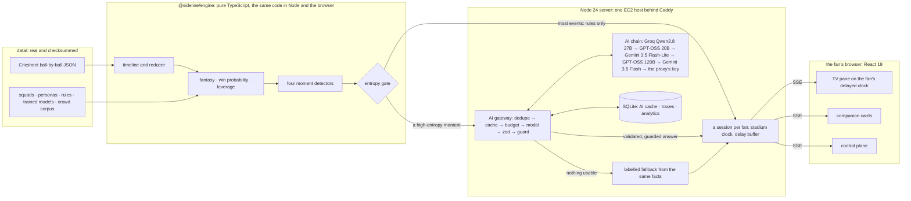

# Sideline: the match, on your clock

> **Dream11 Forward Deployed Engineer Intern assignment** · an AI second-screen companion for live cricket ·
> by **Nabhanyu**

A live T20 loses its fans at four moments. Minutes before lock, a surprise playing XI benches the player you
picked. In the powerplay your captain is out for nothing and the team feels dead. You open the app at over 14 to a
scoreline with no story. And at the climax your stream runs 25 seconds behind a chat that spoils every big ball
before you see it.

**Sideline meets each of those moments, and draws one hard line through the middle of the system: cricket is the
engine's job, words are the model's.** Every run, wicket, win probability, fantasy point, legal swap and settled
prediction is computed by a pure TypeScript engine, whose scorecards and fantasy points are checked against an
independent Python oracle. The model is called only at a high-entropy moment, sees only the facts every fan at that
moment shares, never sees the ball it is teasing, and its answer is schema-checked, guarded by code and cached by
moment, so the AI bill grows with the match, not with the audience. A fan never sees a spoiler their own stream has
not shown, never sees model text that skipped validation, and never sees a template dressed up as AI.

| Moment | Feature | What the fan gets |
| --- | --- | --- |
| Toss to lock | **Lineup Patch** | the legal swaps for a benched pick: code finds them, the model picks one and says why, the validator re-checks it |
| Early collapse | **Bailout** | a comeback quest of yes/no calls, settled by the engine from the real deliveries |
| Joining late | **Catch Me Up** | a reel of the story so far, in plain English or in the fan's own lens (F1, football, …) |
| Climax | **Hold the Spoiler**, **Room Read** | teasers held until the fan's own TV shows the ball; the (synthetic, labelled) watch-along chat as a few debates |

**Live:** <https://sideline.nabhanyubm.tech/> · **Code:** <https://github.com/VirtualHorror/Sideline-Dream11FDEAssignment> ·
**Submission note:** [`docs/SUBMISSION.md`](docs/SUBMISSION.md) · **Demo script:** [`docs/DEMO_SCRIPT.md`](docs/DEMO_SCRIPT.md)

---

## Try it live

**<https://sideline.nabhanyubm.tech/>** (the same server answers at <https://3-108-67-100.sslip.io/>). No login, no
key, nothing to install.

1. Press **Watch the story**. A guided tour plays the real 2022 T20 World Cup match, India v Pakistan at the MCG, as
   *Captain Babar*: a fan who made Babar Azam captain and watches a stream 25 s behind the stadium. It stops at seven
   moments (the table below) and drives the match room for you.
2. Or pick a fan on the landing page. *Late from work* joins the 2022 chase after 14 overs and gets the story so far
   (straight there: [`/match/1298150?persona=late-from-work`](https://sideline.nabhanyubm.tech/match/1298150?persona=late-from-work)).
   The 2024 final (India v South Africa), the second match that shows nothing is hardcoded, has three fans of its own.
3. In the room, open the **control plane**: every gate decision with its reason, every AI call with its model,
   latency, tokens, cost and provenance, the spoiler budget, and the scale projection, all from live counters.
4. Open **`/architecture`**: the pipeline, a live count of what ran without AI, the build plan and every decision,
   rendered from this repository's own docs, so the page cannot drift from the code.

Every AI card says where its words came from: **Live AI**, **Cached for everyone at this moment**, **Replayed AI**
(a recorded real answer) or **Fallback: AI unavailable** (a template filled from the same facts the model would get).

## The system



Real ball-by-ball data → a pure engine (timeline, reducer, fantasy scoring, a win-probability model trained on 3,093
real men's T20Is, four detectors) → an entropy gate that decides, per event, whether anything needs a model → a
session per fan that releases everything on that fan's own delayed TV clock over SSE. No managed services: TLS, app,
database and models run on one host. `docs/Architecture.md` is the long version, `docs/Flow.md` the call paths.

## What was built, task by task

The plan (`docs/PLAN.md`) split the build into ten tasks across three milestones, each task audited and tagged
`t01-verified` to `t10-verified`; an eleventh, the AI chain, came after the submission and was self-audited.

| Task | What it built |
| --- | --- |
| 1 · Foundation | the toolchain, the monorepo, the engine's contracts, real checksummed data, the anti-hardcoding guards, the docs and the app shell |
| 2 · Cricket core | the Cricsheet timeline, the match reducer, fantasy scoring and the engine report |
| 3 · Models | win probability, leverage and player priors trained on 3,093 real men's T20Is, rebuilt byte for byte by one script |
| 4 · Moments engine | the TV clock and the delay buffer, the four moment detectors, the entropy gate that keeps 233 of the 266 events of the 2022 replay away from any model, quest resolution and a seeded synthetic crowd |
| 5 · Server and AI gateway | a session per browser streamed over SSE; the gateway with moment-keyed caching, budgets and labelled fallbacks; spoiler teasers that never see the outcome, catch-up reels and a glossary-first explainer; telemetry with the scale projection |
| 6 · Frontend I | the floodlit landing page and its persona picker; the match room on the fan's delayed TV clock, big balls held under a dither veil until the fan's stream shows them; the control plane; `/architecture` |
| 7 · Deploy (**Milestone A**: the public link) | Caddy and a sandboxed systemd unit on one host, one-command install and redeploy, the replay recorder for keyless demos, the browser tests run against the live site |
| 8 · AI skills II | lineup patches for benched picks, comeback quests the engine settles from real deliveries, room reads of the watch-along chat, and stat-backs and an inspector over a read-only SQL sandbox |
| 9 · Frontend II (**Milestone B**: the complete product) | a card for every moment, the fan's own chat line, the inspector in the control plane, the guided story mode built from the match's own triggers, and `/architecture`'s pipeline, live AI count and build timeline |
| 10 · Final audit (**Milestone C**: the submission) | the whole repository against the independent oracle, a holdout match no code had seen and a whole Cricsheet archive; a security review whose one finding is fixed (BUG-005); the submission note and the demo script |
| 11 · The AI chain | Groq's and Gemini's free tiers ahead of the proxy's key, the key scan, the first replay recording, this README |

## Quickstart (Ubuntu 24.04, no key needed)

Node 24 (24.22 or a later 24.x, `.node-version`), pnpm 10.34 (`corepack enable`, or `npm install -g pnpm@10.34.7`)
and, for the browser tests, Google Chrome.

```bash
git clone https://github.com/VirtualHorror/Sideline-Dream11FDEAssignment.git && cd Sideline-Dream11FDEAssignment
pnpm install --frozen-lockfile
pnpm verify                            # typecheck, lint, unit tests, the hardcoding and key scans, data gate, build
SIDELINE_AI_PROVIDER=none pnpm dev     # http://127.0.0.1:5173, then "Watch the story"
pnpm test:e2e                          # Playwright on system Chrome, desktop and 390 px
```

Without a key every AI card is a recorded real answer (`data/ai-replay/`) or a labelled fallback; nothing spins.

### Run it with your own keys

Copy `.env.example` to `.env` and set any of these; the provider follows the keys (`SIDELINE_AI_PROVIDER`
overrides):

| Key | What runs |
| --- | --- |
| `GROQ_API_KEY` and/or `GEMINI_API_KEY` (free tiers work) | **the AI chain** (D-079): Groq's `qwen/qwen3.8-27b` → `openai/gpt-oss-20b` → Gemini's `gemini-3.5-flash-lite` → Groq's `openai/gpt-oss-120b` → `gemini-3.5-flash` (at most 20 a day) → `OPENAI_API_KEY` if set; the links without a key are left out, and `SIDELINE_AI_CHAIN` changes the order |
| `ANTHROPIC_API_KEY` | Claude (`claude-opus-5-5` by default) |
| `OPENAI_API_KEY` with both `SIDELINE_MODEL_*` (+ `OPENAI_BASE_URL` for another endpoint) | OpenAI, or any OpenAI-compatible Responses API |

```bash
pnpm ai:smoke               # one real teaser through the gateway: provider, model, latency, tokens, cost
pnpm ai:smoke --each-link   # the same teaser to every link of the chain, one request each
pnpm ai:record --yes        # record the replay cache for keyless demos (pnpm ai:record alone only plans)
```

Keys live only in `.env` (git-ignored) and production's root-only env file. `pnpm verify` fails on anything shaped
like a Groq, Google, OpenAI or Anthropic key in a tracked file, or on the first characters of one of this project's
own keys, revoked or live, and prints where, never the key.

---

## Engineering findings from the build and its audits

Five problems, each with a record (a bug file with the red-green evidence, or a decision): an outage outside the
code, three bugs a green suite did not catch, and a planned test that failed because the plan was wrong.

### 1 · The model provider went dark mid-build · `D-067` → `D-071` → `D-079`

**The problem.** The AI key's account ran out of credit mid-build: every call answered `403 key_expired`, and on
2026-10-17 two zero-token diagnostics got `503`. Nothing on the live site could reach a model.

**What the system did.** What it was built to do. Every AI card turned into a labelled fallback, a template filled
from the same facts the model would have seen and marked `Fallback: AI unavailable`, never text passed off as model
output (Constraint 2). The TV's chip switched to "No live AI", and every trace said why:
`provider error: PermissionDeniedError (403, key_expired)`, the status and the body's code, never the provider's
message. The mode follows the provider's last answer, so a restart remembers a dead key and a working one comes
back by itself (D-071).

**The fix.** An ordered **AI chain** over two free tiers, with the paid key last
(`apps/server/src/ai/providers/chain.ts`):

```
groq qwen/qwen3.8-27b → groq openai/gpt-oss-20b → gemini gemini-3.5-flash-lite → groq openai/gpt-oss-120b
→ gemini gemini-3.5-flash (20 a day, counted per Pacific day, kept across restarts) → the proxy's key → labelled fallback
```

A link that answers 429 cools down for its own `retry-after`; a bad key or a missing model for 10 minutes; an outage
for 15 s. While a later link could still answer, a link gets at most half the time left, so one hung provider cannot
eat a teaser's whole budget. When every link is cooling, the chain waits for the soonest only if the call still fits
the deadline. A moment is still one call and one trace: the link that answered, and the links passed over with why.

**Current provider status.** Groq answers: with the rotated key, `pnpm ai:smoke` got a schema-valid teaser that
passed the spoiler linter from `qwen/qwen3.8-27b` in 342 ms. The first Gemini key, Google's new `AQ.` kind, answered
`401 ACCESS_TOKEN_TYPE_UNSUPPORTED` on every endpoint (the documented header, the query parameter, the
OpenAI-compatible endpoint and Vertex AI's express endpoint); its replacement authenticates (Google's model listings
answer `200`) and has not had a per-link check yet. The proxy's key still answers `403 key_expired`. The live site
runs the chain once production's env file has the keys (`sudo deploy/install.sh`); until then it serves the recorded
answers and labelled fallbacks. The last per-link check, with the first Gemini key:

```
$ pnpm ai:smoke --each-link
ai-smoke: link 1 groq qwen/qwen3.8-27b: answered by qwen/qwen3.8-27b in 193 ms, 368 in / 39 out, schema-valid
ai-smoke: link 2 groq openai/gpt-oss-20b: answered by openai/gpt-oss-20b in 464 ms, 443 in / 71 out, schema-valid
ai-smoke: link 3 gemini gemini-3.5-flash-lite: no answer after 121 ms (AuthenticationError (401))
ai-smoke: link 4 groq openai/gpt-oss-120b: answered by openai/gpt-oss-120b in 398 ms, 443 in / 67 out, schema-valid
ai-smoke: link 5 gemini gemini-3.5-flash: no answer after 100 ms (AuthenticationError (401))
ai-smoke: link 6 openai gpt-6.1-sol: no answer after 273 ms (PermissionDeniedError (403, key_expired))
```

### 2 · The 2-second kill switch did not kill anything · `BUG-005`

**The problem.** The NL inspector lets anyone run read-only SQL through a sandbox that stops a query at 2 s. It
answered `timeout` at 2 s, and the query kept running. A four-way cross join of 251 deliveries is about four billion
rows: the process used 1,842, 1,882, 1,829 and 1,741 ms of CPU in the next four two-second windows, and `exit` never
returned. Each "timed out" query also freed its slot, so anyone sending a few queries a minute could pin every core of
the one host the site runs on.

**Why the tests missed it.** They checked that the answer came at 2 s. None checked that the work stopped.

**The fix.** The question was "what does `worker.terminate()` actually stop?" JavaScript, and nothing else:
`StatementSync.all()` loops inside SQLite's native `sqlite3_step`, which never yields, and `node:sqlite` exposes no
progress handler or interrupt. Each query now runs in a child process with an empty environment (no key is ever inside
it), killed with `SIGKILL` once it answers or at 2 s, and a slot frees only when its process has exited
(`apps/server/src/sql/sandbox.ts`).

Red-green: the new test reads the CPU of the test process and its children for a second after the timeout. The old
sandbox used 960 ms of it; a mutant that answers without killing used 1,940; the fix stays under 500. On production, a
seven-way cross join through the public inspector answered `timeout` after 2,066 ms, left no child, and the server used
10 ms of CPU in the next 3 s. The price: about 120 ms to start a process per query, against seconds for a model call.

### 3 · Fans on a slower stream never saw the result · `BUG-004`

**The problem.** Watching the 2022 finish as a fan whose stream runs 25 s behind, the TV folded every ball up to the
winning single and froze. No "India won by 4 wickets", no result outburst. The server had stopped the clock at the
crowd's last reaction in stadium time, and a TV 25 s behind stopped 25 s short. Those are the fans the product is
built for: every one whose delay is longer than the crowd's 22-second tail.

**Why the tests missed it.** They followed the 15-second fan, whose delay is shorter than that tail.

**The fix.** The clock is the server's, so the server keeps it running past the end by the fan's own delay
(`finalT = endT + delayMs`); seeks still stop at the ground's end. Test first: "keeps the clock running until the fan's
delayed TV has shown the match end" failed on the merged code (`expected false to be true`) and passes with the fix.

### 4 · The plan was wrong, not the model · `BUG-003`

**The problem.** The plan named six balls of the 2022 chase as "big balls" the win-probability model must flag. The
trained model put two of them under the threshold of 0.184: the 18.5 six at 0.093 and the winning single at 0.019.

**The rejected fix.** Nudging a weight until the test passes. The plan says to stop and report instead, and a tuned
model would no longer be the one its training data gives.

**The fix.** The probabilities were re-derived in Python from the committed weights (identical to four decimals), then
checked against the data. In the training archive, chases needing one off the last ball were won 26 times out of 27,
because the filters drop tied matches (a tie goes to a super over: more than two innings). So "1 off 1" is almost
always a win, the swing sits on the wide before it (0.86 → 0.99), and the single moves the probability by 0.0097. The
evidence went to the owner, who amended the plan (D-043). Nothing was tuned; the threshold is still the 95th
percentile of the 134,049 real deliveries in the held-out test split.

### 5 · The referee was wrong · `BUG-001`

**The problem.** The independent Python oracle, the auditor's ground truth for every scorecard and fantasy point,
awarded points to substitute fielders in 22 of 199 World Cup matches. A player outside the playing XI scores nothing
(`docs/DOMAIN.md` §3); the engine had it right and the oracle did not.

**Why the tests missed it.** Neither demo match has a substitute with a fielding credit.

**The fix.** Running both over the whole ICC men's T20 World Cup archive, 230 matches, not just the two the code was
built on, showed it. With the owner's approval the oracle was fixed (D-038), and its output turned out not to be
byte-stable either (Python's randomised string hashing reorders a set), so outputs are compared as data. Since then:
199 identical, 31 rejected loudly with documented reasons (BUG-002: mid-over bowler changes, seven-ball overs), and 0
wrong numbers.

Two smaller findings, both checks that passed or failed for the wrong reason. In the final audit, two deploy dry-run
tests passed on the only host that had ever run them and failed in a fresh clone (they planned against this host's
real `/srv/sideline` and `.env`); they now run on a deploy checkout of their own. And after the replay recording,
`pnpm ai:smoke` answered its teaser from the recorded cache and reported `FAILED` without asking the provider; it now
builds its runtime without the recordings, and a test runs the real script against a stand-in endpoint on loopback
(D-081).

---

## The AI boundary

**The model writes the words and proposes; code computes, checks and decides. The model never computes a number,
settles a prediction or decides what a fan may see.**

| Capability | Who does it | Why |
| --- | --- | --- |
| Score, overs, run rates, batting and bowling cards | **deterministic** (reducer) | arithmetic over real deliveries |
| Fantasy points, squad legality, credits | **deterministic** (scoring, validator) | the rules a contest is decided by |
| Win probability, leverage, "is this a big ball?" | **a trained logistic model**, not an LLM | numbers come from 3,093 real T20Is |
| Which XI change hurts your squad, the legal swaps | **deterministic** (detector, validator) | legality is code |
| Lineup Patch: picking among the legal swaps, saying why | **LLM** → zod → illegal swaps dropped → validator | explanation is language; legality is re-checked |
| Spoiler teaser for a big ball | **LLM**, with the ball's outcome left out of the prompt → spoiler linter | it cannot leak what it was never told |
| Holding the card until the fan's TV shows the ball | **deterministic** (delay buffer, TV clock) | timing is a clock, not a guess |
| Bailout quest: the yes/no questions | **LLM** proposes typed rules → guard checks each rule's window | the questions are language |
| Bailout quest: who called it right | **deterministic** (quest resolver over the real deliveries) | the engine settles it, never the model |
| Catch Me Up reel | **LLM** over the facts the engine ranked → every citation checked | storytelling is language |
| Room Read of the watch-along chat | **LLM** clusters the (synthetic, labelled) chat → message ids checked | |
| Stat-back of a fan's take, the NL inspector | **LLM** writes SQL → validator → read-only sandbox, killed at 2 s | the database computes the numbers |
| A glossary term ("what is a free hit?") | **lookup**, no model | |
| A routine ball (a dot, a single, a two) | **the gate** → deterministic | 233 of the 266 events in the 2022 replay |

Every call has a moment key, a schema, a timeout, a fallback and a trace (Constraint 11). The prompt for a shared
moment carries only what every fan at that moment shares: no fan's squad, no fan's chat line (D-045). Fan text sits
escaped inside its own tag in every prompt, and nothing a model writes is executed, except SQL inside the read-only
sandbox.

## Verification & scale metrics

Each number below comes from a command, a test or a doc in this repository; the source is beside it.

| What | Number | From |
| --- | --- | --- |
| Events of the 2022 replay handled by rules alone | **233 of 266** | the control plane, `docs/DEMO_SCRIPT.md` |
| A naive call per event per fan at 10 million viewers | **2,660,000,000** calls | the scale projection (`docs/Architecture.md` §6) |
| Sideline at the same scale | **about 99.6% fewer** (99.999999% with no personal moments) | the same projection, from live counters |
| Engine vs the independent oracle | **identical** on both demo matches, on holdout matches no code had seen (the 2026 final and semi-final), and on 199 of the 230 World Cup archive matches; the other 31 are rejected loudly, never answered wrong | `scripts/oracle/audit/`, `docs/features/F08-ai-skills-2.md`, `docs/features/F10-final-audit.md` |
| Win-probability model | trained on **3,093** men's T20Is; rebuilt from the recorded archive **byte for byte** | `node scripts/build-models.ts --zip …` |
| Unit tests | **811** in 61 files, no skips | `pnpm test` |
| Browser tests | **26** (desktop and 390 px), locally and against production | `pnpm test:e2e` |
| Standing mutants killed | **18 of 18** | `scripts/oracle/audit/mutate.py` |
| The replay recording through the AI chain | **87 of 91** shared moments, in 124 calls over three passes; $0.10 at list prices, $0 billed on the free tier | `pnpm ai:record --yes`, `docs/features/F11-ai-chain-and-readme.md` |
| The AI chain, link by link | **3 of 6 answered** at the last per-link check (Groq's three, 193-464 ms), before the Gemini key was rotated | `pnpm ai:smoke --each-link` |
| A live teaser with the rotated keys | answered by Groq's `qwen/qwen3.8-27b` in **342 ms** (368 tokens in, 34 out) | `pnpm ai:smoke` |

### Notes and known limits

- **AI providers.** Groq answers with the rotated key. The proxy's key is out of credit (`403 key_expired`). The
  first Gemini key answered `401` on every endpoint; the rotated one authenticates and has not had a per-link check
  yet. Production's env file gets the chain's keys with one `sudo deploy/install.sh`; until then the live site serves
  the recorded answers and labelled fallbacks.
- **Lighthouse on this host follows its load.** Production scored phone 92, desktop 90 and accessibility 100 after
  the Task 9 deploy; the final audit measured phone 75-89 and desktop 73-78 on the same code while the host's load
  average was 7-8, every point lost to blocking time. Accessibility stayed at 100 in every run.
- **The fantasy rules are illustrative.** Points and credits are our own table (`data/rules/t20-fantasy.json`,
  `docs/DOMAIN.md`), not Dream11's, and every page's footer says Sideline is a concept prototype, not an official
  Dream11 product.

## What the guided story shows

| Stop | Moment | What it proves |
| --- | --- | --- |
| 1 | The playing XIs are announced | code diffs the XI against the fan's squad and lists only legal swaps; the model picks and explains; the validator re-checks |
| 2 | Babar lbw to Arshdeep for 0, first ball of the second over | a comeback quest of yes/no calls, settled by the engine from the real deliveries |
| 3 | The chase after 14 overs, as *Late from work* | a catch-up reel from engine-ranked facts, in the fan's own lens (plain English, F1, football, …) |
| 4 | The chase's 18.6 | the teaser held under a veil: the stadium has seen the ball, this fan's stream has not |
| 5 | The reveal: Kohli's six off Haris Rauf | the card opens on the fan's TV clock; the broadcast delay is the AI's latency budget |
| 6 | The room read | a firehose of (synthetic, labelled) chat becomes a few debates |
| 7 | The result | "That's the match."; then the control plane and the inspector |

## What is simulated, and what is real

| Simulated | How | What is real |
| --- | --- | --- |
| A live match | a real Cricsheet match replayed on a stadium clock you can pause, speed up and jump | every delivery, wicket and result, checked against the raw file |
| The fan's stream delay | 15-40 s per persona, adjustable | the delay buffer and the TV clock the whole product runs on |
| The watch-along chat | a seeded synthetic crowd from an authored corpus, labelled synthetic wherever it appears | the clustering, the guards on it, and your own chat line |
| Fantasy squads, credits, personas | authored fixtures in `data/matches/` | the scoring and legality code, and the oracle that checks it |
| The AI | real model calls through the chain, or real recorded answers (`data/ai-replay/`, written only by `pnpm ai:record`), or labelled fallbacks | every one says which it is |

## Verify it yourself

```bash
pnpm verify                     # rows 1-6 of docs/TEST_CHECKLIST.md: 61 test files, 811 tests, "no forbidden words, no keys"
pnpm test:e2e                   # 26 passed
# the engine's scorecard and fantasy points, then the independent oracle's: compared as data, they are identical
node scripts/engine-report.ts data/raw/cricsheet/1298150.json \
  --players data/matches/1298150/players.json --rules data/rules/t20-fantasy.json --json
python3 -I scripts/oracle/cricsheet_oracle.py data/raw/cricsheet/1298150.json \
  --players data/matches/1298150/players.json --rules data/rules/t20-fantasy.json --json
pnpm ai:record                  # the replay plan: what a keyless demo needs, sending nothing
curl -fsS https://sideline.nabhanyubm.tech/api/health   # the deployed version, provider and AI chain (never a key)
```

## More commands

```bash
pnpm dev                              # web on http://127.0.0.1:5173, proxying /api to the server on :8787
SIDELINE_AI_PROVIDER=none pnpm dev    # the same without calling the AI provider in .env
pnpm build && pnpm start              # the production build on :8787 (the deployed server uses :8780)

# scorecard + fantasy points for a match, straight from the engine (--json for the oracle's format)
node scripts/engine-report.ts data/raw/cricsheet/1298150.json \
  --players data/matches/1298150/players.json --rules data/rules/t20-fantasy.json

# rebuild data/models (win probability, leverage threshold, priors) from Cricsheet's T20I archive
node scripts/build-models.ts          # or --zip <saved t20s_male_json.zip> for an exact rebuild

# deploy on the EC2 host (deploy/README.md): once with sudo, then redeploys and rollbacks without
deploy/install.sh --dry-run && sudo deploy/install.sh
deploy/update.sh                      # main; or a tag such as t07-verified to roll back
PLAYWRIGHT_BASE_URL=https://sideline.nabhanyubm.tech pnpm test:e2e   # the browser tests, live
```

The API: `GET /api/matches` (and `/:matchId`, `/:matchId/story`), `POST /api/sessions`,
`GET /api/sessions/:id/stream` (SSE), and per session `POST …/control`, `…/ask`, `…/lineup-intent`, `…/chat` and
`…/inspector`; `GET /api/inspector/views`, `GET /api/telemetry`, `GET /api/health`. The route map is at the top of
`apps/server/src/http/app.ts`; the flows are in `docs/Flow.md` (§2, §7-8, §13, §16-18).

Production (`deploy/README.md`): Caddy with automatic HTTPS in front of a sandboxed systemd unit on one EC2 host,
serving a deploy checkout of this repository; the AI keys reach it only through the root-only env file that
`install.sh` writes from `.env`, and `update.sh` redeploys or rolls back to any `tNN-verified` tag.

## Repository map

| Path | What |
| --- | --- |
| `packages/engine` | the pure, isomorphic core: contracts, Cricsheet timeline, reducer, fantasy, models, detectors, gate, quests, story |
| `apps/server` | Node 24 + Hono (runs `.ts` directly): sessions, SSE, the AI gateway and chain, skills and guards, the SQL sandbox, SQLite |
| `apps/web` | React 19 + Vite 8 + Tailwind 4: landing, match room, control plane, `/architecture` |
| `data/` | real Cricsheet data with checksums, authored fixtures, rules, trained models, the crowd corpus, recorded AI (`data/README.md`) |
| `scripts/` | data fetch and checks, the hardcoding and key scan, the engine report, the model build, the AI smoke and recorder, the independent Python oracle and the auditor's toolkit |
| `e2e/` | Playwright tests, also run against production |
| `deploy/` | the install and update scripts, the Caddyfile and unit templates, the runbook |
| `docs/` | Architecture, Flow, Decisions, Constraints, PLAN, TEST_CHECKLIST, ROLLBACK, DOMAIN, the bug and feature register, the submission note (`SUBMISSION.md`) and the demo script (`DEMO_SCRIPT.md`); the previous README is `docs/README.v1.md` |

## How it was built

Two agents and a written process. **Claude Code** was the architect and auditor: it designed the system, wrote the
plan, Task 1 and every audit, and, while Codex was unavailable, implemented Tasks 3 to 9, the final audit (Task 10)
and the AI chain (Task 11). **OpenAI Codex** implemented the cricket core (Task 2) on its own branch. Every decision,
flow, constraint, test command and rollback path was written down as it happened: `docs/Decisions.md` (why),
`docs/Flow.md` (how execution travels), `docs/features/` (one file per task), `docs/TEST_CHECKLIST.md` (what proves
it), `docs/ROLLBACK.md` (how to undo it). The bugs above were found by a security review, a sweep of a whole archive,
the plan's own checks and watching the product run, not by the suite that was already green.

## Credits and licences

- Ball-by-ball data: [Cricsheet](https://cricsheet.org), Open Data Commons Attribution License 1.0.
- Typeface: Anek Latin by Ek Type (OFL-1.1), self-hosted via Fontsource.
- Markdown on `/architecture`: markdown-it (MIT).
- A concept prototype, not an official Dream11 product.

Made with 💖 by Nabhanyu for Dream11 - Forward Deployed Engineer Intern - Assignment
